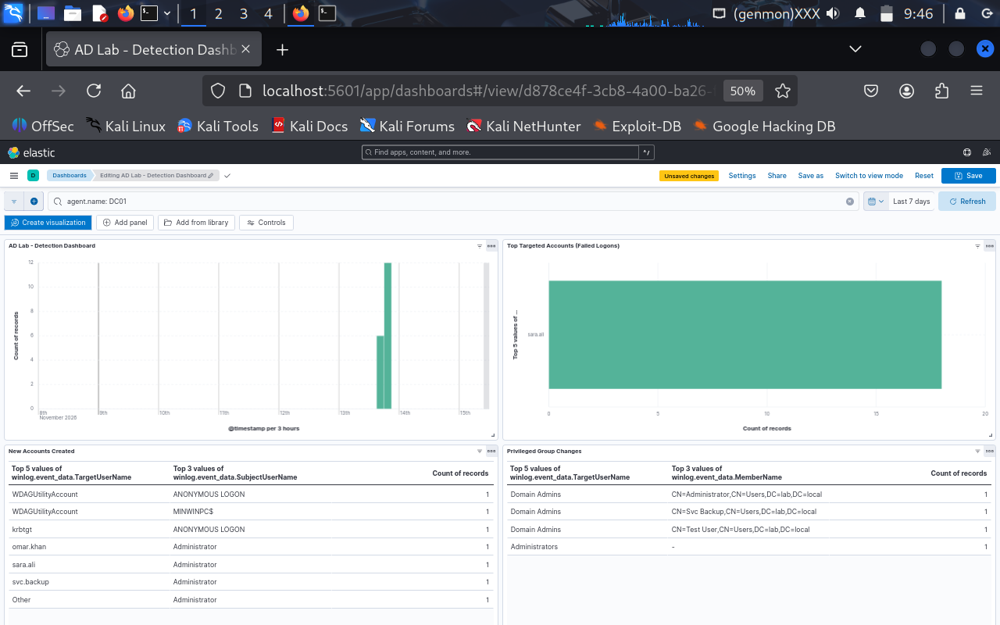
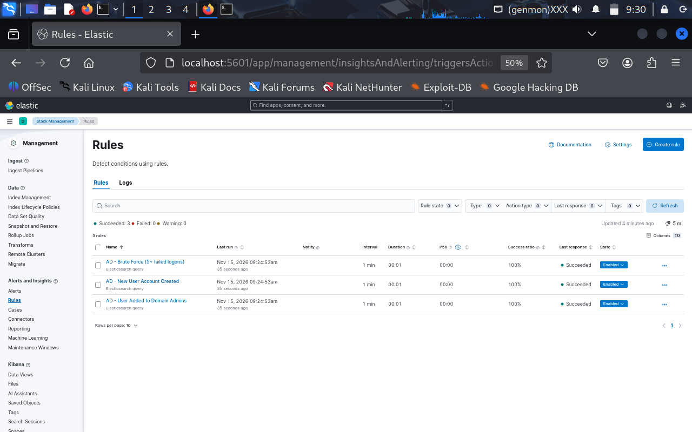
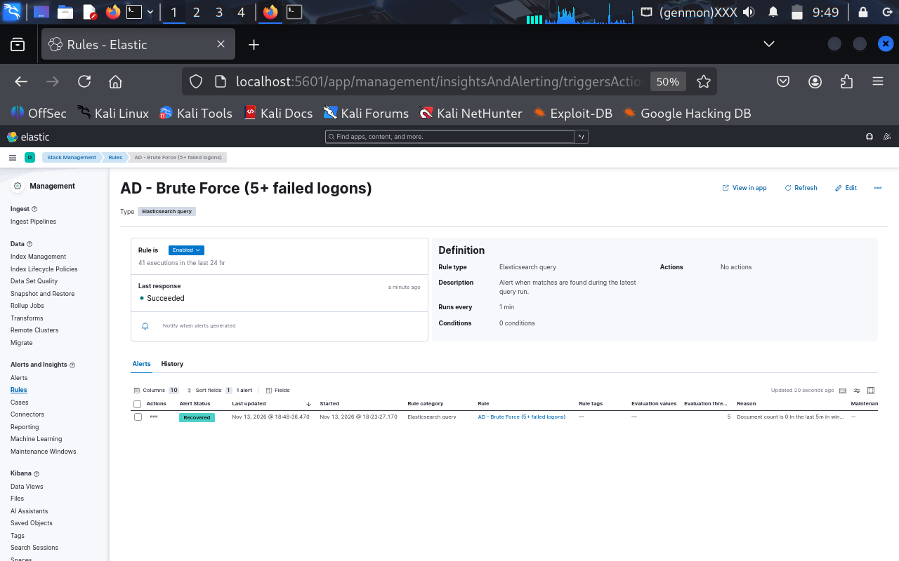
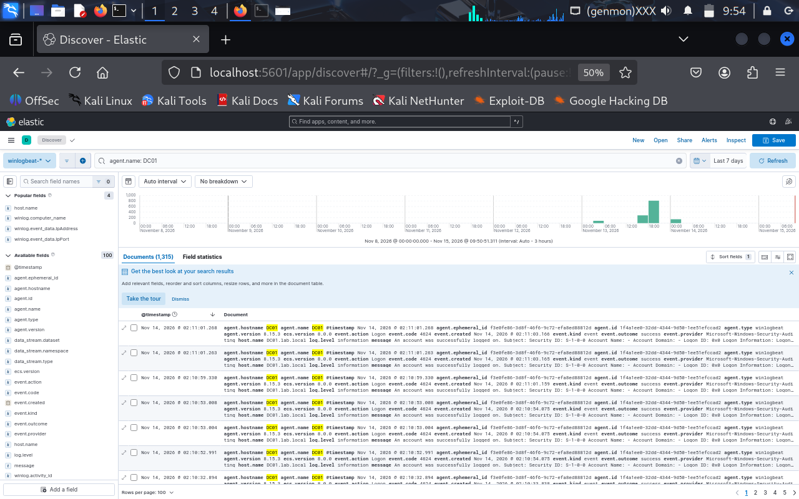

# Active Directory Detection Lab

A small, isolated lab that simulates suspicious activity against an Active Directory domain and detects it with Elastic. The goal is to practice the defender's side: collect Windows logs, build a dashboard, and write detection rules that map to real attacker behavior.

## Architecture

    DC01 (Windows Server 2022, domain lab.local)
        |  Winlogbeat
        v
    Elasticsearch (Docker, Linux VM)
        |
        v
    Kibana (dashboard and detection rules)

    Network: host-only, no internet

- **Domain Controller (DC01):** Windows Server 2022, domain `lab.local`, DNS and AD DS.
- **Log shipping:** Winlogbeat on the DC sends selected Windows events to Elasticsearch.
- **SIEM:** Elasticsearch and Kibana 8.15 running in Docker on a Linux VM (see my [Mini SIEM project](https://github.com/abbasol/mini-siem-elastic)).
- **Network:** Host-only. The DC has no gateway and no internet access. Elasticsearch is bound to the lab interface only, never to a public one.

## Lab setup

| Item | Detail |
|---|---|
| OUs | Employees, IT |
| Users | Standard users, an IT user, and a service account |
| Audit policy | Logon, account management, and Kerberos subcategories enabled with `auditpol` |
| Collected logs | Security (selected event IDs) and PowerShell Operational (4104) |

## Events collected

| Event ID | Meaning |
|---|---|
| 4624 / 4625 | Successful / failed logon |
| 4720 | User account created |
| 4726 | User account deleted |
| 4728 / 4732 | Member added to a security group |
| 4768 / 4769 | Kerberos ticket requests |
| 4104 | PowerShell script block logging |

## Detection rules

All rules are Kibana Elasticsearch query rules that run every minute over a 5 minute window.

| Rule | Query (KQL) | Threshold | Attacker behavior |
|---|---|---|---|
| Brute force | `agent.name: DC01 and event.code: "4625"` | 5 or more | Password guessing |
| User added to privileged group | `agent.name: DC01 and event.code: (4728 or 4732) and winlog.event_data.TargetUserName: ("Domain Admins" or "Administrators" or "Enterprise Admins")` | above 0 | Privilege escalation |
| New user account created | `agent.name: DC01 and event.code: "4720"` | above 0 | Persistence |

## Dashboard

The Kibana dashboard shows:

- Failed logons over time
- Top targeted accounts (failed logons)
- New accounts created
- Privileged group changes

Screenshots are in `docs/` (sanitized: no real hostnames, IPs, or personal data).

## How I tested

1. Generated repeated failed logons against a domain account.
2. Created a new user and added a service account to Domain Admins.
3. Confirmed each rule moved to **Active**, then to **Recovered** once the events left the 5 minute window.

## Lessons learned

- **Clock sync matters.** The DC's timezone and clock were wrong, so events appeared "in the future" and Kibana's time range hid them. Fixing the timezone and enabling time sync solved it. In a real SOC, bad timestamps break detection and timelines.
- **Recovered does not mean resolved.** The alert only means no new matching events were seen in the window. An analyst still has to investigate the source, the targeted account, and whether a successful logon (4624) followed the failures.
- **Window size is a trade-off.** A long window creates false positives. A very short one misses slow attacks.
- **Keep secrets out of the repo.** The Kibana encryption key lives in a git-ignored `.env` file.

## Limitations and next steps

- Single DC, no real users or noisy baseline traffic.
- Rules have no actions (no email or chat notification).
- Planned: failed logon followed by a successful one, Kerberos anomalies, and PowerShell script block alerts.

## Disclaimer

This lab runs on isolated virtual machines for learning only. All accounts and passwords are lab-only.

## Screenshots

### Detection dashboard

### Detection rules

### Alert history (Active, then Recovered)

### Events collected from DC01

